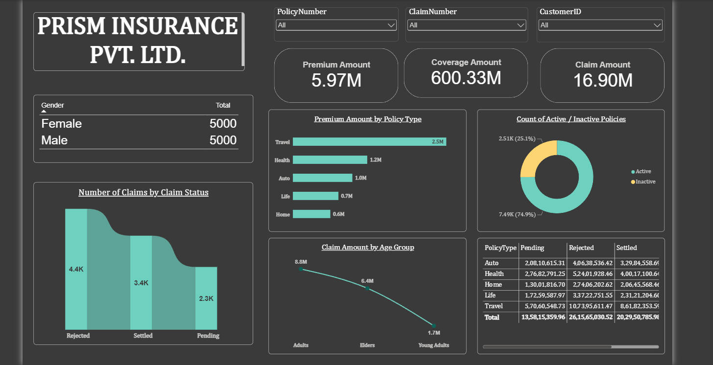

# Insurance Analytics Dashboard | Power BI

An interactive Power BI dashboard for analyzing insurance premiums, coverage, claims, and policy activity.

## Project Overview

This project analyzes insurance data through an interactive dashboard to explore premium amounts, coverage, claim status, and policy activity. It provides a visual overview of insurance portfolio metrics and helps identify patterns across policy types and age groups.

## Project Objectives

- Analyze key insurance performance indicators.
- Explore claim status distribution.
- Compare premium amounts across policy types.
- Analyze claim amounts across age groups.
- Examine active and inactive policy status.
- Enable interactive filtering of insurance records.

## Dataset

- **Dataset:** InsuranceData.csv
- **Records after cleaning:** 10,000
- **Data type:** Synthetic sample insurance data for practice and portfolio use.

The dataset contains insurance-related fields such as policy number, customer ID, gender, age, policy type, premium amount, coverage amount, claim amount, and claim status.

## Tools & Technologies

- Microsoft Power BI Desktop
- Power Query

## Dashboard Features

- KPI cards for total premium, total coverage, and total claim amount
- Premium amount by policy type
- Claim amount by age group
- Policy count by claim status
- Active versus inactive policy analysis
- Policy count by gender
- Coverage amount by policy type and claim status
- Interactive slicers for filtering the dashboard

## Data Preparation

- Reviewed and removed duplicate records.
- Checked data types and prepared the data for analysis.
- Created age groups for comparing claim amounts.
- Categorized policies as Active or Inactive using the project's reference date.

## Business Questions

- What are the total premium, coverage, and claim amounts?
- How do premium amounts vary across policy types?
- What is the distribution of claim statuses?
- Which age groups account for the largest claim amounts?
- How are policies distributed between Active and Inactive status?

## Key Insights

- Total premium is approximately **5.97 million**.
- Total coverage is approximately **600 million**.
- Total claim amount is approximately **16.9 million**.
- Travel is the largest policy type, representing approximately **41% of policies** and **2.48 million in premium**.
- Claim status distribution is approximately **43.5% Rejected, 33.9% Settled, and 22.6% Pending**.
- Adults aged 25–60 account for approximately **8.8 million** in claim amount.
- Approximately **75% of policies are Active**, using 12 October 2024 as the reference date.

These findings are based on a synthetic practice dataset and should not be interpreted as actual insurance industry performance.

## Dashboard Preview

## How to Use

1. Download `Insurance_Analytics_Dashboard.pbix` from this repository.
2. Open the file in Microsoft Power BI Desktop.
3. Explore the KPI cards, charts, and interactive slicers.

## Project Purpose

This project was developed as part of a data analytics portfolio to demonstrate data preparation, Power BI dashboard development, interactive data visualization, and business insight communication.

## Author

**Tanisha Dey Sarkar**

- [GitHub Profile](https://github.com/tanisha-dey-sarkar)
- [LinkedIn Profile](www.linkedin.com/in/tanisha-dey-sarkar-tds)
